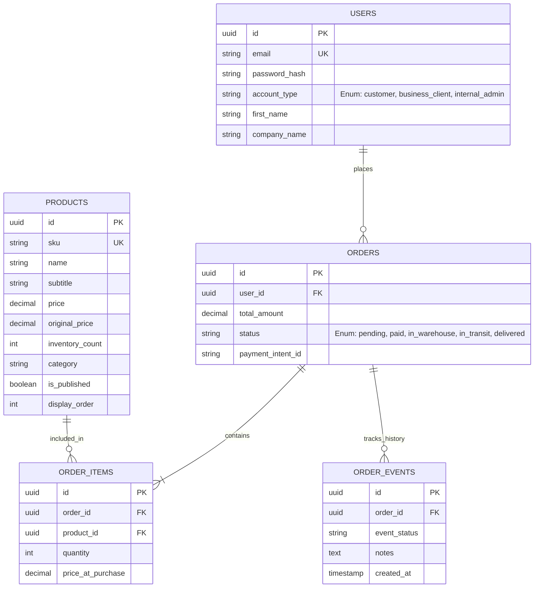

# Database Schema

#database #postgresql #sqlite #orm

The Squad Wear database is designed with ACID compliance, utilizing SQLAlchemy async ORM models supporting both **PostgreSQL** in production and **SQLite (`squadgear.db`)** as an automatic local development fallback.

---

## 📊 Entity Relationship Diagram

---

## ⚙️ Core Models (`backend/models.py`)

### `Product` Model
- `id`: Primary key string / UUID
- `sku`: Unique inventory SKU identifier (e.g., `SQD-HD-BLK-350`)
- `name`: Product display name
- `subtitle`: Fabric details (e.g., `Midnight Black / 350 GSM Cotton Fleece`)
- `price`: Numeric retail price
- `category`: Category group (`Tracksuits`, `Hoodies`, `Trousers`)
- `is_published`: Boolean controlling live catalog visibility
- `display_order`: Custom sorting index for catalog placement

---

## 🔗 Related Notes
- [[System Overview]]
- [[FastAPI Backend & DB Pipeline]]
- [[Catalog Management Scripts]]
