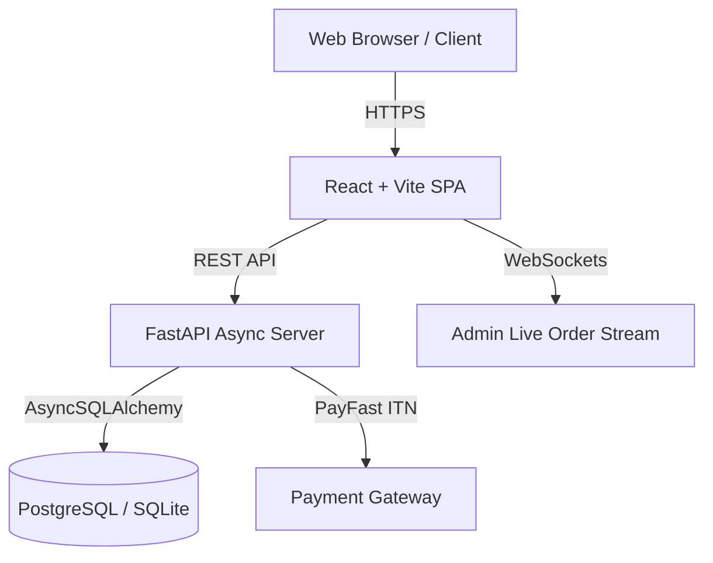

# System Overview

#architecture #system-design

**Squad Wear** is an e-commerce platform specializing in streetwear (Tracksuits, Hoodies, Trousers). The system is built with a decoupled architecture featuring a modern React SPA frontend and a high-performance FastAPI asynchronous backend.

---

## 🏗 High-Level Architecture

---

## 🛠 Technology Stack

| Layer | Technology | Purpose |
| :--- | :--- | :--- |
| **Frontend Framework** | React 18 + Vite | SPA rendering & fast HMR |
| **Styling** | Tailwind CSS + Geist Fonts | Modern minimalist streetwear typography |
| **Backend Framework** | FastAPI (Python 3.11+) | Async API endpoints & WebSocket broadcasting |
| **Database ORM** | AsyncSQLAlchemy + AsyncPG / AIOSQLite | Non-blocking async database transactions |
| **Rate Limiting** | SlowAPI | Protection against DDoS & brute force attacks |
| **Authentication** | OAuth2 + JWT (PyJWT / Passlib) | Secure role-based authorization |

---

## 🔗 Related Notes
- [[Database Schema]]
- [[API Reference]]
- [[React Frontend Architecture]]
- [[FastAPI Backend & DB Pipeline]]
